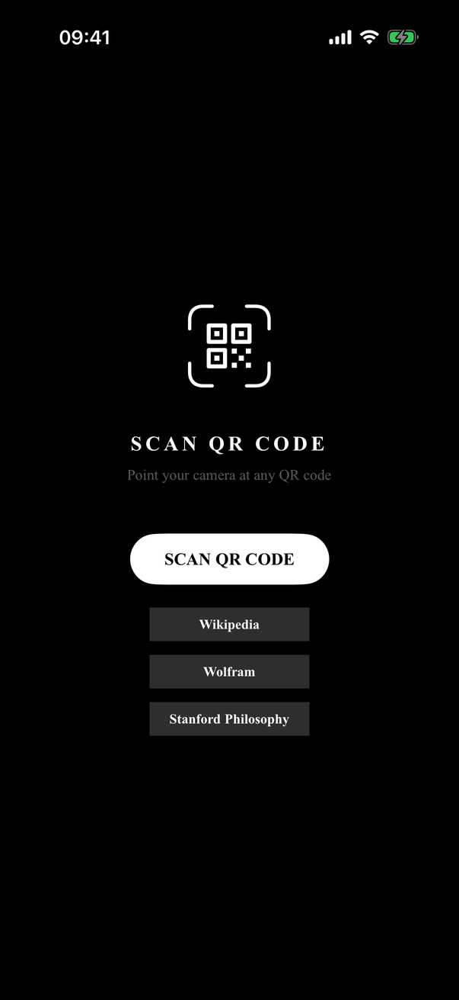
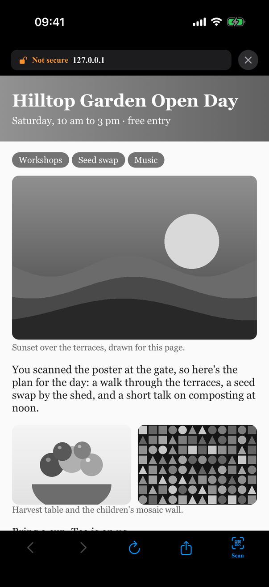
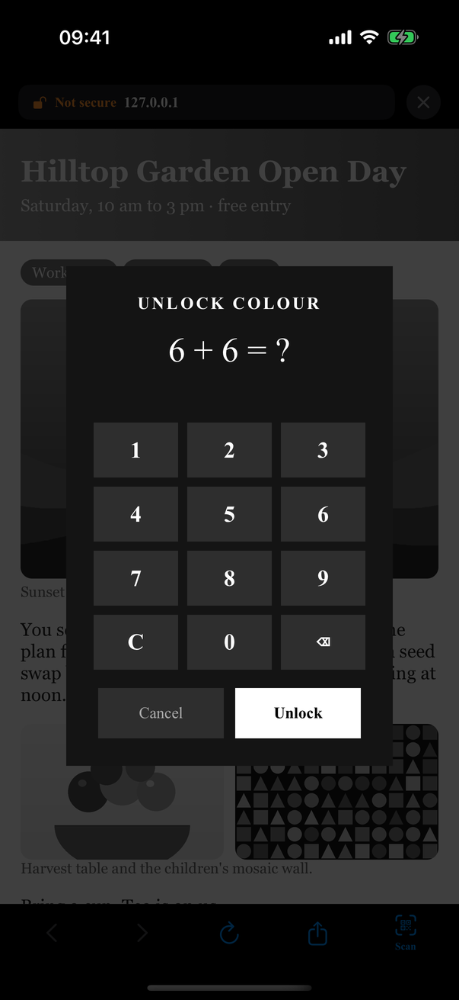
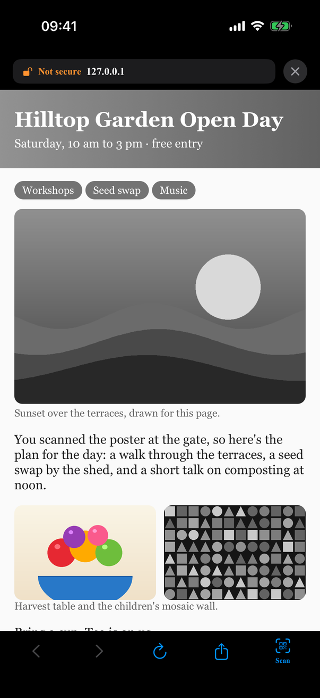

# NoBrowser

A deliberately inconvenient iOS web browser. There's no address bar and no
search: the only ways in are scanning a QR code or one of three built-in sites
(Wikipedia, Wolfram Alpha and the Stanford Encyclopedia of Philosophy). Every
page renders in black and white, and bringing an image back to colour costs you
a small maths problem.

<p>
  
  
  
  
</p>

## What it's for

Using the web on purpose. You open the page you meant to open, say from a QR
code on a poster, a menu or a slide, read it, and leave. With no address bar
there's nowhere to wander off to, and without colour pages are less
attention-grabbing. If you really want to see an image properly, a sum is the
small price.

## How it works

- **Scan to enter.** The home screen has one button, *Scan QR code*, which uses
  VisionKit's `DataScannerViewController`. Only `http` and `https` codes are
  accepted; Wi-Fi, contact and plain-text codes are ignored.
- **Greyscale pages.** An injected script adds a fixed overlay with
  `backdrop-filter: grayscale(100%)` that desaturates everything beneath it.
  Tapping an image opens a puzzle; solve it and the image is cloned above the
  overlay in full colour, reusing the page's own decoded bytes. Solved images
  stay unlocked until you navigate away. Images inside iframes stay grey
  because taps in subframes can't be intercepted.
- **Out of the page's reach.** The script and its message handler run in a
  separate WebKit content world, so the page's own JavaScript can't call them or
  fake an image tap. If a page removes or restyles the overlay, it's put back.
  This is a nudge, not a security boundary: a page that really wants to can
  still get around a cosmetic overlay.
- **Stays in the browser.** Pages can only navigate to `http`, `https`,
  `blob:` and `about:blank`/`about:srcdoc` (plus `data:` inside frames). Links
  to `tel:`, `sms:`, `mailto:`, the App Store, other apps' URL schemes, files
  and top-level `data:` URLs are silently cancelled. `target="_blank"` links
  and `window.open` open in the same view, since there are no tabs.
- **Honest address pill.** The top bar shows only the host (never the path, so
  `example.net/www.yourbank.com` can't pass for your bank). A green padlock
  means `https` with no insecure content; plain `http` or mixed content shows
  an open padlock and *Not secure*.
- **Minimal chrome.** Back, forward, reload, share and *Scan* again. Nothing else.

### Links from other apps and the default browser

`Info.plist` declares the `http`/`https` URL schemes and the project includes
`NoBrowser/NoBrowser.entitlements` with `com.apple.developer.web-browser`, but
**the entitlement isn't enabled**: the target doesn't reference it, because
signing fails for anyone Apple hasn't approved for it.

On iOS, declaring `http`/`https` on its own does nothing: the system sends web
links to the default browser, and only an app with the default-browser
entitlement can be chosen as that. So, as shipped, links from other apps open
in Safari (or whatever your default is), not NoBrowser. The app's `onOpenURL`
handler is there for when the entitlement is enabled.

To make NoBrowser selectable as the default browser, first
[request the entitlement from Apple](https://developer.apple.com/documentation/xcode/preparing-your-app-to-be-the-default-browser),
then set `CODE_SIGN_ENTITLEMENTS = NoBrowser/NoBrowser.entitlements` on the
NoBrowser target (Build Settings, *Code Signing Entitlements*). After that it
can be chosen as the default browser in the iOS Settings app.

## Requirements

- Xcode 26 and iOS 26.5 or later.
- A real iPhone for QR scanning (the camera scanner doesn't run in the
  Simulator). Everything else works in the Simulator.

## Build & run

1. Open `NoBrowser.xcodeproj`.
2. Under **Signing & Capabilities**, choose your own team and change the bundle
   identifier from `com.example.nobrowser` to one of your own.
3. Run on your device and grant camera access on first launch.

To try it, generate a QR code for any `https://` URL with any QR generator and
point the camera at it.

### Debug launch arguments

Debug builds only (the code is inside `#if DEBUG`). Useful in the Simulator,
where there's no camera and `simctl openurl http://…` goes to Safari:

| Argument | Effect |
| --- | --- |
| `-NBDebugOpenURL <http(s) URL>` | Opens that page at launch. |
| `-NBDebugTapImage <n>` | After the first page loads, simulates a tap on the nth `` (0-based), which opens the puzzle. |
| `-NBDebugSolvePuzzle YES` | When the puzzle appears, enters the correct answer and submits it a few seconds later. |

For example:

```sh
xcrun simctl launch booted com.example.nobrowser \
  -NBDebugOpenURL http://127.0.0.1:8000/ -NBDebugTapImage 1 -NBDebugSolvePuzzle YES
```

`docs/demo-site/` has the original page used for the screenshots
(`python3 -m http.server 8000 --bind 127.0.0.1` from that folder) and
`selftest.html`, which checks the content-world isolation, the overlay
restoring itself and the blocked link schemes.

## Project layout

| File | Purpose |
| --- | --- |
| `NoBrowserApp.swift`, `ContentView.swift` | App entry; routes scans and opened links to the browser |
| `Views/ScanGateView.swift` | Home screen: scan button and the three built-in sites |
| `Views/ScannerView.swift` | `DataScannerViewController` wrapper with viewfinder overlay |
| `Views/BrowserView.swift` | Browser chrome, security indicator and the colour-unlock maths puzzle |
| `WebView/WebViewModel.swift` | Navigation state and unlocked-image tracking |
| `WebView/WebViewRepresentable.swift` | `WKWebView` wrapper: greyscale overlay script, image-tap bridge, navigation policy |
